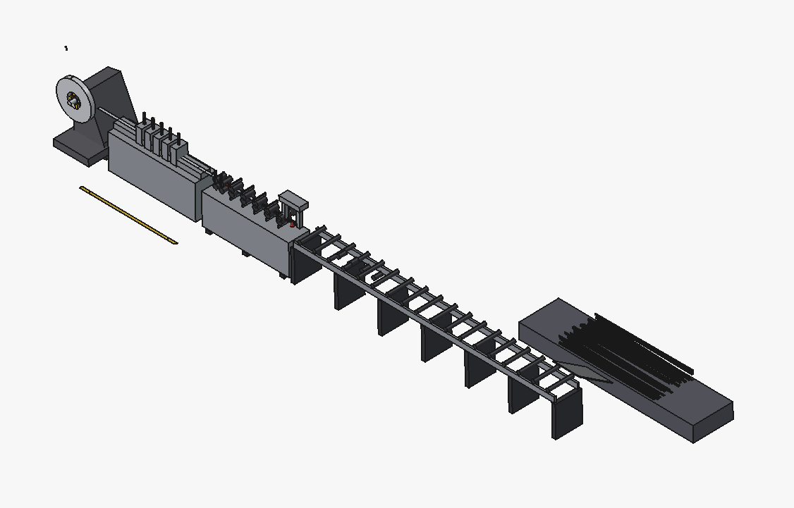
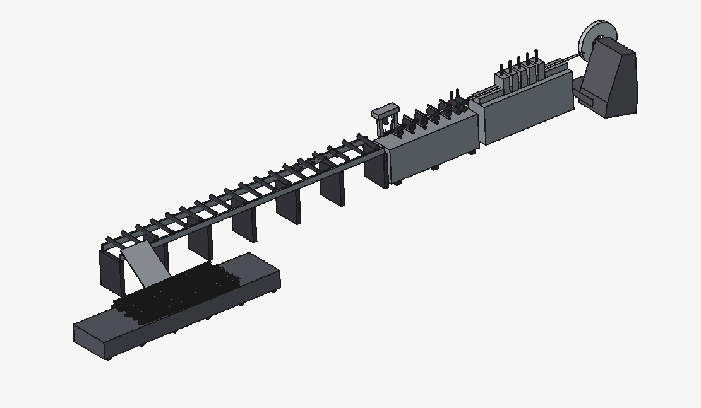
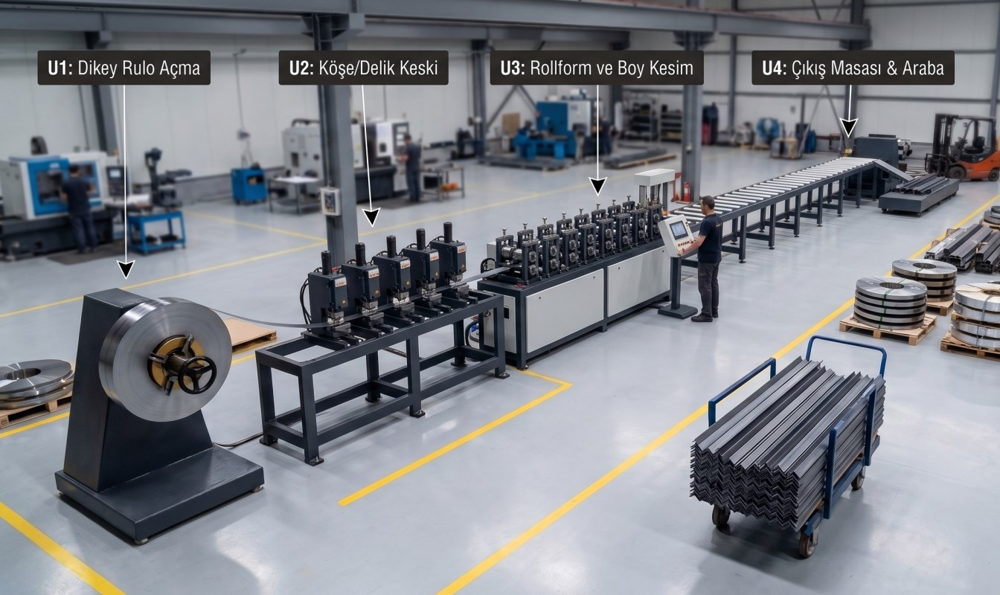

# Draft to Render: Turning a Rough CAD Layout into a Quote-Ready Visual

A rollform production line, sketched as a rough concept assembly, turned into a
photorealistic factory-floor image for a client proposal — using the CAD draft
itself as the visual reference, not a generic stock photo.

## Step 1 — Rough concept in FreeCAD

Blocked out fast: uncoiler, punch/notch stations, the rollform + cut-to-length
unit, output table. Not toleranced, not detailed — just enough to lock the
station count, order, and rough footprint before committing to a proposal.

  
  

## Step 2 — The same layout, rendered

The draft above — same station count, same order, same proportions — became the
reference for an AI-generated photorealistic render of the finished line on a
factory floor, labeled with the process stations:

- **U1** — Uncoiling (vertical decoiler)
- **U2** — Corner/hole punching
- **U3** — Rollforming and cut-to-length
- **U4** — Output table and cart

## Why this matters

Proposal visuals for a client normally mean either a real photo of a line that
doesn't exist yet, or a generic stock image that looks nothing like the actual
machine. Grounding the AI render in an actual CAD layout closes that gap — the
render matches the real station count, order, and proportions, not just "a
rollform line in general." Going from rough concept to a client-ready visual
took a fraction of the time a full render pass or a photo shoot would.

## About

Mechanical design engineer (SolidWorks, 11 years, 100+ projects).
[linkedin.com/in/nizamyuksel](https://www.linkedin.com/in/nizamyuksel/)

## License

MIT — reuse the write-up and the approach. Images are mine; ask before reuse.
